<h1 align="center">💊 MediCare</h1>


<p align="center">

  
  
  
  
  
</p>


<p align="center">
  <strong>A full-stack pharmacy delivery platform with real-time GPS tracking, multi-role dashboards, and integrated payment processing.</strong>
</p>

<p align="center">
  <a href="https://medicare-pharma.vercel.app/" target="_blank"><strong>🌐 Live Demo</strong></a> •
  <a href="#-features">Features</a> •
  <a href="#-tech-stack">Tech Stack</a> •
  <a href="#-architecture">Architecture</a> •
  <a href="#-getting-started">Getting Started</a> •
  <a href="#-user-roles">User Roles</a> •
  <a href="#-api-reference">API Reference</a> •
  <a href="#-project-structure">Project Structure</a>
</p>

---

## 🔗 Live Demo

Experience the live application here:  
👉 **[https://medicare-pharma.vercel.app](https://medicare-pharma.vercel.app/)**

---

## 🚀 Quick Demo Logins

Test all 4 distinct platform roles instantly on the live app without registration:

| Role                   | Demo Email              | Password      | Access Dashboard | Key Features to Test                                                                |
| :--------------------- | :---------------------- | :------------ | :--------------- | :---------------------------------------------------------------------------------- |
| **💊 Pharmacy Owner**  | `owner@medicare.com`    | `owner123`    | `/owner`         | 20% Net Profit live analytics, New Orders pipeline, stock catalog management        |
| **🚗 Delivery Driver** | `driver@medicare.com`   | `driver123`   | `/driver`        | Live GPS streaming, OTP verification celebration modal, ৳35 wallet credit           |
| **🔐 System Admin**    | `admin@medicare.com`    | `admin123`    | `/admin`         | Platform oversight, driver approval, system-wide order & revenue tracking           |
| **🛒 Customer**        | `customer@medicare.com` | `customer123` | `/dashboard`     | 1000+ medicines catalog, prescription upload, live Chittagong map delivery tracking |

---

## 🔄 End-to-End Real-Time Workflow

MedeCare synchronizes **Customers**, **Pharmacy Owners**, and **Delivery Couriers** through a real-time event-driven state machine:

```mermaid
flowchart LR
    subgraph STAGE1["🛒 1. Customer"]
        C1["Browse 1000+ Meds<br/>or Upload Rx"] --> C2["Checkout<br/>COD / SSLCommerz"]
    end

    subgraph STAGE2["💊 2. Pharmacy"]
        P1["'New Orders' Tab<br/>🔔 Socket.IO Alert"] --> P2["Verify &amp; Pack<br/>Status: Ready"]
    end

    subgraph STAGE3["🚗 3. Delivery Rider"]
        D1["Accept Delivery<br/>Chittagong GPS"] --> D2["Live OSRM Route<br/>Proximity &lt; 300m"]
    end

    subgraph STAGE4["🔐 4. OTP Handshake"]
        O1["Customer Shares<br/>4-Digit Secret OTP"] --> O2["Driver Inputs OTP<br/>Real-Time Verify"]
    end

    subgraph STAGE5["💰 5. Settlement"]
        S1["🎉 Delivered<br/>Rider: +৳35 Wallet<br/>Owner: +20% Profit"]
    end

    C2 -->|"⚡ order:newOrder"| P1
    P2 -->|"📡 Broadcast"| D1
    D2 -->|"📍 Arrived"| O1
    O2 -->|"✅ Verified"| S1

    classDef c fill:#eff6ff,stroke:#3b82f6,stroke-width:2px,color:#1e40af,rx:10px
    classDef p fill:#faf5ff,stroke:#a855f7,stroke-width:2px,color:#6b21a8,rx:10px
    classDef d fill:#ecfeff,stroke:#06b6d4,stroke-width:2px,color:#0e7490,rx:10px
    classDef o fill:#fefce8,stroke:#eab308,stroke-width:2px,color:#854d0e,rx:10px
    classDef s fill:#ecfdf5,stroke:#10b981,stroke-width:2px,color:#065f46,rx:10px

    class C1,C2 c
    class P1,P2 p
    class D1,D2 d
    class O1,O2 o
    class S1 s
```



### ⚡ 5-Stage Operational Pipeline

| Stage | Actor | Real-Time Trigger | Status Transition | Outcome & Financial Split |
| :---: | :--- | :--- | :--- | :--- |
| **`01`** | **🛒 Customer** | `POST /api/orders` | `Pending` | Order placed with Chittagong GPS coordinates & items |
| **`02`** | **💊 Pharmacy** | Socket `order:newOrder` | `Pending` ➔ `Confirmed` ➔ `Ready` | Lands in **"New Orders"** tab; inventory batch auto-deducted |
| **`03`** | **🚗 Rider** | Broadcast `order:newAvailable` | `Ready` ➔ `Picked Up` ➔ `In Transit` | Live GPS streaming via Leaflet + Chittagong OSRM engine |
| **`04`** | **🔐 Handshake** | Haversine `< 300m` Doorstep | `In Transit` ➔ `Arrived` | Customer reveals secret 4-digit OTP; zero-fraud verification |
| **`05`** | **💰 Settlement**| Socket `order:completed` | `Arrived` ➔ `Delivered` | **+৳35.00** to Driver Wallet · **+20% Net Profit** to Owner |

### ⚡ 2-Minute End-to-End Testing Guide

Anyone testing the repository can verify the entire multi-role pipeline in **5 simple steps**:

| Stage  | Action                   | Role & Dashboard           | What Happens in Real Time                                                                             |
| :----: | :----------------------- | :------------------------- | :---------------------------------------------------------------------------------------------------- |
| **1**  | **Place Order**          | `Customer` (`/dashboard`)  | Select any medicine (e.g., _Napa Extra_), choose _Cash on Delivery_, and checkout.                    |
| **2**  | **Fulfill Prescription** | `Owner` (`/owner/orders`)  | Order instantly rings in **"New Orders"** tab. Click **"Accept"** → **"Prepare"** → **"Mark Ready"**. |
| **3**  | **Accept Delivery**      | `Driver` (`/driver`)       | Delivery broadcast alert arrives. Click **"Accept Order"** and **"Pick Up"**.                         |
| **4**  | **Live GPS Route**       | `Customer` (`/orders/:id`) | Open customer tracking view to watch live rider navigation along Chittagong roads.                    |
| **5**  | **OTP Completion**       | `Driver` (`/driver`)       | Click **"Arrived"**, input customer's 4-digit OTP, and click **"Verify"**.                            |
| **🎉** | **Result**               | _Instant Payout_           | Driver earns **+৳35.00** wallet credit; Owner dashboard receives **+20% Net Profit**!                 |

---

## 🌟 Features

### 🛒 Customer Experience

- **Medicine Catalog** — Browse 1000+ medicines across 8 categories (Pain Relief, Antibiotics, Vitamins, Cold & Flu, Digestive, Diabetes, Heart, Skin Care)
- **Smart Search** — Full-text search with category filtering and instant results
- **Shopping Cart & Wishlist** — Persistent cart with quantity management and wishlist support
- **Prescription Upload** — Upload prescriptions for pharmacist verification and fulfillment
- **Online Payment** — SSLCommerz payment gateway integration with Cash on Delivery fallback
- **Order Tracking** — Real-time GPS tracking on an interactive Leaflet map with live driver location updates

### 📍 Real-Time Delivery Tracking

- **Live GPS Updates** — WebSocket-powered driver location broadcasting via Socket.IO
- **Interactive Map** — Leaflet-based map showing pharmacy → driver → customer route
- **Auto-Arrival Detection** — Haversine distance calculation auto-triggers "Arrived" status at 300m proximity
- **OTP Verification** — 4-digit OTP confirmation for secure delivery handoff
- **Order Timeline** — Visual step-by-step progress indicator from placement to delivery

### 💊 Pharmacy Owner Dashboard

- **Inventory Management** — Add, edit, and manage medicine listings with images, pricing, and stock levels
- **Order Processing** — Accept/reject orders, update preparation status, and manage fulfillment pipeline
- **Revenue Analytics** — Track monthly revenue with interactive Recharts-powered graphs
- **Real-Time Notifications** — Instant new order alerts via Socket.IO pharmacy dashboard rooms

### 🚗 Driver Dashboard

- **Delivery Management** — View available deliveries, accept orders, and manage active routes
- **Live Location Broadcasting** — Real-time GPS coordinate streaming to customers and pharmacy owners
- **OTP-Based Delivery** — Enter customer OTP to confirm successful delivery
- **Wallet System** — Track earnings with built-in driver wallet
- **Registration & Approval** — Multi-step driver registration with NID, driving license, and vehicle verification

### 🔐 Admin Panel

- **User Management** — View, search, and manage all registered users across all roles
- **Driver Approval** — Review and approve/reject pending driver registrations
- **Pharmacy Oversight** — Monitor all registered pharmacies and their performance
- **Medicine Catalog Control** — Global oversight of all medicine listings
- **Order Monitoring** — Track and manage all orders system-wide

### 🔑 Authentication & Security

- **JWT Authentication** — Secure token-based authentication with role-based access control
- **Google OAuth 2.0** — One-click Google Sign-In via `@react-oauth/google`
- **Password Hashing** — bcrypt-based password security
- **Helmet & CORS** — HTTP security headers and cross-origin request handling
- **Rate Limiting** — Express rate limiter to prevent brute-force attacks
- **Input Validation** — Joi schema validation on all API endpoints

---

## 🛠 Tech Stack

### Frontend

| Technology                  | Purpose                                                        |
| --------------------------- | -------------------------------------------------------------- |
| **React 18**                | UI framework with component-based architecture                 |
| **TypeScript**              | Type safety across the entire frontend                         |
| **Vite 5**                  | Lightning-fast build tool and dev server                       |
| **TailwindCSS 3**           | Utility-first CSS with custom design system                    |
| **Radix UI**                | Accessible, unstyled UI primitives (Dialog, Tabs, Toast, etc.) |
| **React Router 6**          | Client-side routing with nested layouts                        |
| **TanStack React Query**    | Server state management with caching                           |
| **Zustand**                 | Lightweight global state management                            |
| **Framer Motion**           | Smooth page transitions and micro-animations                   |
| **Leaflet + React Leaflet** | Interactive maps for live order tracking                       |
| **Recharts**                | Data visualization for analytics dashboards                    |
| **Socket.IO Client**        | Real-time WebSocket communication                              |
| **Zod + React Hook Form**   | Form validation and management                                 |
| **Lucide React**            | Beautiful, consistent icon library                             |

### Backend

| Technology             | Purpose                                         |
| ---------------------- | ----------------------------------------------- |
| **Node.js + Express**  | RESTful API server                              |
| **TypeScript**         | Type safety across the entire backend           |
| **MongoDB + Mongoose** | Document database with ODM                      |
| **Socket.IO**          | Real-time bidirectional WebSocket communication |
| **JWT**                | Stateless authentication tokens                 |
| **bcryptjs**           | Secure password hashing                         |
| **Joi**                | Request payload validation                      |
| **Helmet**             | HTTP security headers                           |
| **Morgan**             | HTTP request logging                            |
| **SSLCommerz**         | Payment gateway integration                     |

---

## 🏗 Architecture

```
┌─────────────────────────────────────────────────────────────┐
│                        CLIENT (React)                       │
│  ┌──────────┐ ┌──────────┐ ┌──────────┐ ┌───────────────┐  │
│  │ Customer │ │  Owner   │ │  Driver  │ │     Admin     │  │
│  │Dashboard │ │Dashboard │ │Dashboard │ │    Panel      │  │
│  └────┬─────┘ └────┬─────┘ └────┬─────┘ └──────┬────────┘  │
│       │             │            │               │          │
│  ┌────┴─────────────┴────────────┴───────────────┴───────┐  │
│  │              Zustand Store + React Query               │  │
│  └───────────────────┬───────────────────────────────────┘  │
│                      │ HTTP + WebSocket                     │
└──────────────────────┼──────────────────────────────────────┘
                       │
┌──────────────────────┼──────────────────────────────────────┐
│                 SERVER (Express + Socket.IO)                 │
│  ┌───────────────────┴───────────────────────────────────┐  │
│  │                   API Routes                          │  │
│  │  /auth  /medicines  /orders  /delivery  /payment ...  │  │
│  └───────────────────┬───────────────────────────────────┘  │
│  ┌───────────────────┴───────────────────────────────────┐  │
│  │              Middleware Layer                          │  │
│  │      JWT Auth · Rate Limit · Helmet · Validation      │  │
│  └───────────────────┬───────────────────────────────────┘  │
│  ┌───────────────────┴───────────────────────────────────┐  │
│  │              Socket.IO (Real-Time Layer)               │  │
│  │   Live Tracking · Order Updates · Pharmacy Alerts     │  │
│  └───────────────────┬───────────────────────────────────┘  │
│                      │                                      │
└──────────────────────┼──────────────────────────────────────┘
                       │
              ┌────────┴────────┐
              │    MongoDB      │
              │  (Mongoose ODM) │
              └─────────────────┘
```


## 👥 User Roles

| Role | Access | Key Capabilities |
|------|--------|-------------------|
| **Customer** | `/dashboard` | Browse medicines, place orders, track deliveries, upload prescriptions, manage wishlist |
| **Owner / Pharmacy** | `/owner` | Manage inventory, process orders, view analytics, receive real-time order alerts |
| **Driver** | `/driver` | Accept deliveries, broadcast live location, complete deliveries with OTP verification |
| **Admin** | `/admin` | Full platform oversight — manage users, drivers, pharmacies, medicines, and orders |

---

## 📡 API Reference

| Endpoint Group | Base Path | Description |
|---|---|---|
| **Authentication** | `/api/auth` | Register, login, Google OAuth, token refresh |
| **Medicines** | `/api/medicines` | CRUD operations, search, filter by category |
| **Orders** | `/api/orders` | Place orders, update status, fetch order history |
| **Delivery** | `/api/delivery` | Driver assignment, location updates, OTP verification |
| **Payment** | `/api/payment` | SSLCommerz payment initiation, success/fail callbacks |
| **Pharmacies** | `/api/pharmacies` | Pharmacy registration and management |
| **Users** | `/api/users` | Profile management, role updates |
| **Dashboard** | `/api/dashboard` | Analytics data for owner/admin dashboards |
| **Admin** | `/api/admin` | User/driver approval, platform-wide management |
| **Images** | `/api/images` | Medicine image upload and serving |

### WebSocket Events

| Event | Direction | Description |
|---|---|---|
| `join_room` | Client → Server | Join order tracking room |
| `driver_location_update` | Driver → Server | Broadcast GPS coordinates |
| `location_changed` | Server → Client | Live driver location to all watchers |
| `order:statusChanged` | Server → Client | Order status transition notification |
| `pharmacy:joinDashboard` | Owner → Server | Join pharmacy dashboard for real-time alerts |

---

## 📁 Project Structure

```
Medicare/
├── Backend/
│   ├── config/              # Environment and app configuration
│   ├── middleware/           # Auth, error handling, privacy middleware
│   ├── routes/              # Express route handlers
│   │   ├── authRoutes.ts        # Authentication & registration
│   │   ├── medicineRoutes.ts    # Medicine CRUD & search
│   │   ├── orderRoutes.ts       # Order lifecycle management
│   │   ├── deliveryRoutes.ts    # Driver assignment & tracking
│   │   ├── paymentRoutes.ts     # SSLCommerz integration
│   │   ├── pharmacyRoutes.ts    # Pharmacy management
│   │   ├── userRoutes.ts        # User profile operations
│   │   ├── dashboardRoutes.ts   # Analytics & reporting
│   │   ├── adminRoutes.ts       # Admin panel endpoints
│   │   └── imageRoutes.ts       # Image upload & serving
│   ├── cache/images/        # Cached medicine images
│   ├── data/                # Seed data & import files
│   ├── scripts/             # Database utilities & import scripts
│   ├── models.ts            # Mongoose schemas (User, Pharmacy, Medicine, Order)
│   ├── db.ts                # MongoDB connection
│   ├── index.ts             # Express server + Socket.IO setup
│   └── seed.ts              # Database seeding script
│
├── Frontend/
│   ├── public/images/       # Static medicine images
│   ├── src/
│   │   ├── components/
│   │   │   ├── ui/              # Radix-based UI primitives (shadcn/ui)
│   │   │   ├── layout/          # Header, RootLayout, RequireAuth, RequireRole
│   │   │   ├── dashboard/       # Dashboard layout components
│   │   │   ├── driver/          # Driver registration form
│   │   │   ├── LiveOrderMap.tsx  # Leaflet real-time tracking map
│   │   │   ├── MedicineCard.tsx  # Product card component
│   │   │   ├── OrderTimeline.tsx # Visual order progress tracker
│   │   │   └── EditProfileDialog.tsx
│   │   ├── pages/
│   │   │   ├── HomePage.tsx          # Landing page with hero & categories
│   │   │   ├── MedicinesPage.tsx     # Medicine catalog with search/filter
│   │   │   ├── MedicineDetailPage.tsx # Single medicine view
│   │   │   ├── CartPage.tsx          # Shopping cart
│   │   │   ├── CheckoutPage.tsx      # Checkout with map picker
│   │   │   ├── OrderTrackingPage.tsx # Live delivery tracking
│   │   │   ├── LoginPage.tsx         # Multi-panel auth page
│   │   │   ├── owner/               # Pharmacy owner dashboard pages
│   │   │   ├── driver/              # Driver dashboard
│   │   │   ├── admin/               # Admin panel pages
│   │   │   └── payment/             # Payment success/fail pages
│   │   ├── store/
│   │   │   └── useAppStore.ts   # Zustand global state
│   │   ├── hooks/               # Custom React hooks
│   │   ├── lib/                 # API client, types, utilities
│   │   └── App.tsx              # Root component with routing
│   ├── tailwind.config.ts   # Custom design system
│   └── vite.config.ts       # Vite configuration
│
└── README.md
```

